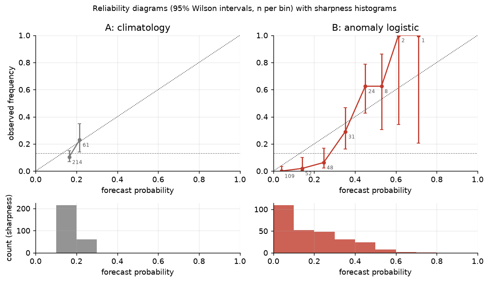

# heatcast: probabilistic extreme-heat forecasting for Rajshahi

[](https://github.com/N-A-F-I-Z/Temperature-Anomalies-Forecasting/actions/workflows/ci.yml)

**Question.** At the start of any day in April or May, what is the probability that Rajshahi, Bangladesh, will see **at least two days above its calendar-day 90th-percentile maximum temperature in the next seven days**? And do recent temperature anomalies predict that better than climatology does?

This is a small, honest forecasting experiment. It covers 35 years of ERA5-Land reanalysis, four statistical models, a hindcast in which no model sees the future, and verification with proper scoring rules.

📄 **Full write-up:** [`docs/writeup.md`](docs/writeup.md) · 📊 **Results:** [`results/report.md`](results/report.md)



## What's inside

| | |
|---|---|
| **Data** | ERA5-Land daily `temperature_2m_max` from Google Earth Engine (`ECMWF/ERA5_LAND/DAILY_AGGR`), 1991–2025. Open-Meteo's ERA5-Land archive is a no-account alternative. **The published results use Open-Meteo**, as a way to get familiar with it instead of only the traditional GEE pipeline. |
| **Event** | ≥ 2 days in [t, t+6] above the 1991–2020 calendar-day 90th percentile (ETCCDI TX90p construction) |
| **Models** | **A** climatological frequency · **A2** climatology + warming trend · **B** logistic regression on recent anomalies · **B2** B + trend |
| **Hindcast** | expanding window, 2021–2025 (plus a 2001–2025 robustness run). Every model is trained only on prior years, and its predictors use only data available at issue time. |
| **Verification** | Brier score and skill score, Murphy decomposition (reliability / resolution / uncertainty), reliability diagrams with Wilson intervals, sharpness, ROC AUC, log loss, moving-block bootstrap confidence intervals |
| **Extras** | a data-latency sweep (how quickly does anomaly skill decay?) · leakage unit tests · an auto-generated write-up in which every number comes from the latest run |

## Quick start

```bash
git clone https://github.com/N-A-F-I-Z/Temperature-Anomalies-Forecasting && cd Temperature-Anomalies-Forecasting
python -m venv .venv && source .venv/bin/activate
pip install -e ".[gee,openmeteo,dev]"

# Real data (pick one)
earthengine authenticate && export EE_PROJECT=your-gcp-project
heatcast fetch --source gee
#   or, with no account:
heatcast fetch --source openmeteo

heatcast run      # hindcast → results/, figures, results/report.md, docs/writeup.md
pytest            # 14 tests, including look-ahead leakage checks
```

To try the pipeline without downloading anything, run `heatcast all --source synthetic`. It uses a stochastic Rajshahi-like series and stamps every report with a **synthetic-data** warning.

## Repository layout

```
config.toml                 every experimental choice in one place
src/heatcast/
  data.py                   GEE / Open-Meteo / synthetic fetchers, validation
  climatology.py            calendar-day percentiles, means, anomalies
  events.py                 event labels and issue dates
  features.py               predictors restricted to the information available at issue time
  models.py                 climatology + logistic models
  hindcast.py               expanding-window hindcast
  verification.py           Brier, decomposition, reliability, sharpness, bootstrap
  plots.py, report.py       figures and auto-generated reports
  pipeline.py, cli.py       end-to-end runner and the `heatcast` command
docs/writeup_template.md    write-up source (prose + placeholders)
docs/writeup.md             rendered write-up (generated)
scripts/gee_code_editor.js  the same extraction for the Earth Engine Code Editor
tests/                      unit and leakage tests
```

## Design choices worth noting

- **No look-ahead.** Predictors for issue date *t* use data from *t − latency* and earlier. Models for year *Y* are trained on years before *Y*. Thresholds come from 1991–2020, which ends before the first test year. `tests/test_leakage.py` enforces all of this by corrupting future data and asserting that the forecasts do not change.
- **Honest uncertainty.** Forecasts issued on consecutive days share six of their seven window days. Confidence intervals therefore come from a block bootstrap, not i.i.d. resampling, which would overstate certainty.
- **Ablations, not just a winner.** A2 and B2 separate the value of the long-term warming signal from the value of short-term persistence.
- **Operational realism.** ERA5-Land arrives about five days after real time. The latency sweep shows how much skill an operational version would lose.

## Data licence

ERA5-Land is distributed under the Copernicus licence. *Contains modified Copernicus Climate Change Service information; neither the European Commission nor ECMWF is responsible for any use of this information.* Code: MIT.
