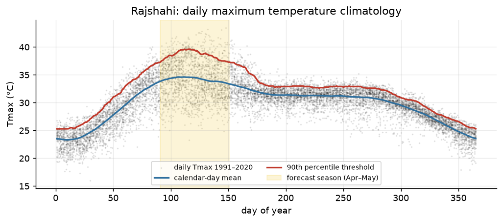
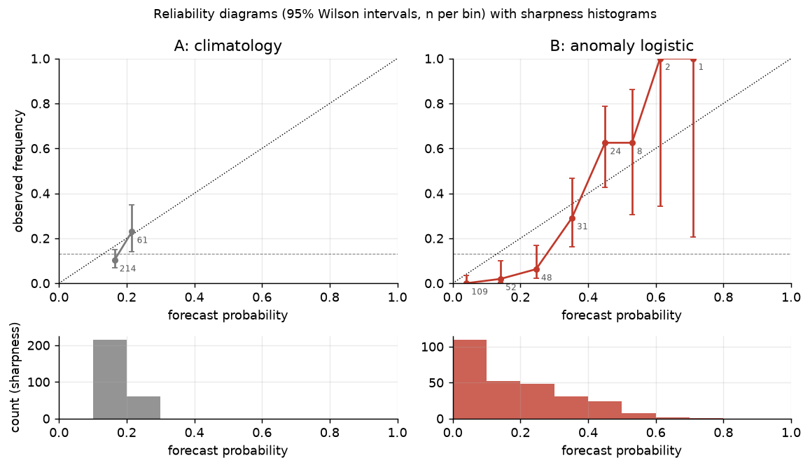
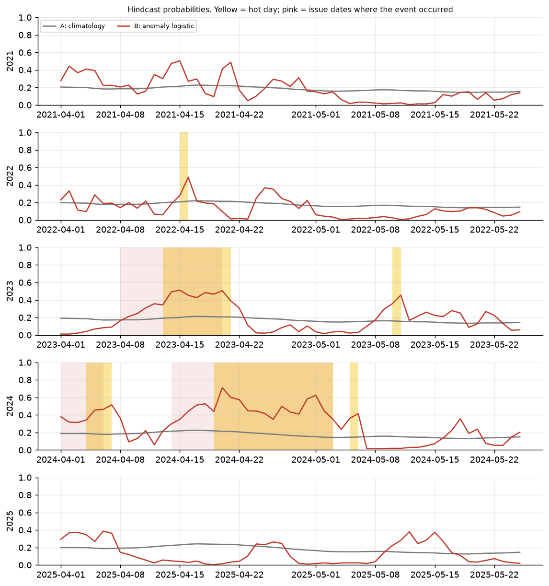
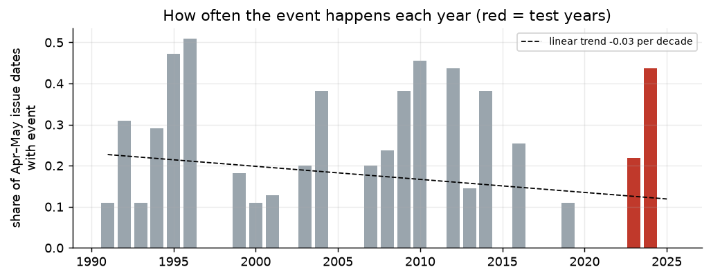
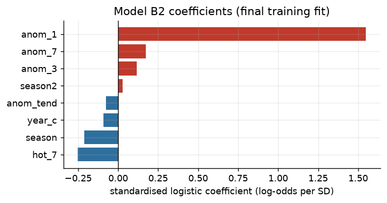
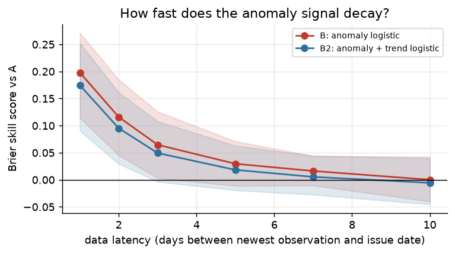

# Can recent temperature anomalies sharpen extreme-heat forecasts for Rajshahi?

*A probabilistic hindcast experiment with ERA5-Land, 1991–2025*


## Summary

Rajshahi, in north-west Bangladesh, is one of the hottest places in the country. Its pre-monsoon season (April–May) brings repeated heat spells. This project asks a narrow, testable forecasting question. **At the start of any day in April or May, what is the probability that the next seven days will include at least two days hotter than the local calendar-day 90th percentile?**

I compare four statistical forecasts of that event: a climatological baseline, a climatology that warms with time, and two logistic regressions that also use the temperature anomalies of the past week. Each model is tested in an expanding-window hindcast over 2021–2025. A model is trained only on years before the one it forecasts, and its predictors use only data that existed on the issue date. The forecasts are scored with the Brier score and its decomposition, reliability diagrams, sharpness and ROC AUC, with block-bootstrap confidence intervals.

**Main result.** Over the 275 April–May issue dates in 2021–2025, the anomaly-adjusted model (B) scored a Brier score of 0.079 against 0.112 for climatology (A): a Brier skill score of +0.29 (95% block-bootstrap interval +0.08 to +0.43). That is a clear improvement on climatology (the 95% interval excludes zero).

## 1. Motivation

Bangladesh's highest recorded temperature, 45.1 °C, was measured in Rajshahi in May 1972 [1]. In late April 2024 the city reached 43 °C, its hottest reading in decades, during what the Bangladesh Meteorological Department described as the country's longest heatwave on record [2, 3]. Heat early warning works on time scales of days to a week. Before relying on dynamical models, it is worth asking a simple question: how much predictability does the observed state of the atmosphere carry on its own? If last week's anomalies say little about next week's heat, an early-warning system has to lean on numerical weather prediction. If they say a lot, a cheap statistical benchmark already beats climatology. Either way, such a benchmark is the bar any more complex system has to clear.

## 2. Data

- **Source:** ECMWF ERA5-Land reanalysis, daily maximum 2 m temperature [4]. Grid spacing is about 0.1° (≈ 11 km). The pipeline can read it from Google Earth Engine (`ECMWF/ERA5_LAND/DAILY_AGGR`, band `temperature_2m_max`, UTC days) [5] or from the Open-Meteo historical archive (`models=era5_land`, local days in `Asia/Dhaka`).
- **Location:** the grid cell containing Rajshahi city (24.3745° N, 88.6042° E). A spatial mean over a buffer is available as an option.
- **Period:** 1991-01-01 to 2025-12-31. Data source for this run: `openmeteo`.
- **Preprocessing:** values are converted to °C where needed (GEE delivers kelvin). Gaps of up to 3 days are linearly interpolated, and the loader fails loudly on longer gaps or implausible units.

ERA5-Land is a reanalysis, not a station record. It smooths local extremes and can be biased against the BMD Rajshahi station. Because the event is defined by *percentiles of the same dataset*, a constant bias cancels out. Bias that changes with temperature does not, and Section 7 returns to this.

## 3. The forecast question

| Element | Definition |
|---|---|
| Hot day | daily Tmax above the calendar-day 90th percentile. The percentile is estimated over 1991–2020 (the WMO standard normal) with a ±7-day pooling window, as in the ETCCDI TX90p index. In April–May the threshold ranges from 37.3 to 39.6 °C. |
| Event E(t) | ≥ 2 hot days in the 7-day window [t, t+6] |
| Issue dates | every day from 1 April to 25 May, so that every window ends by 31 May (55 forecasts per year) |
| Information set | observations up to day t − 1 (1-day latency); the latency is varied from 1 to 10 days in Section 6.4 |
| Test period | 2021–2025 (275 forecasts; observed base rate 13%) |

The 1991–2020 base period ends before the first test year, so the event definition itself never uses test-period data. The configuration loader enforces this.



## 4. Models

| Model | Predictors | Role |
|---|---|---|
| **A — climatology** | none: the share of past issue dates within ±7 calendar days on which E occurred (estimated as (k+0.5)/(n+1)) | baseline from the study design |
| **A2 — climatology + trend** | season position, season², year | does the warming trend alone add skill? |
| **B — anomaly logistic** | season position, season², anomaly at t−1, mean anomaly over 3 days and 7 days, hot-day count in the last 7 days, anomaly tendency (3-day − 7-day mean) | anomaly-adjusted model from the study design |
| **B2 — anomaly + trend** | B's predictors + year | both signals together |

Anomalies are departures from a smoothed 1991–2020 calendar-day mean. The logistic models standardise their predictors and use mild L2 regularisation (C = 1). These four models form an **ablation**: comparing A→A2 isolates the long-term trend, A→B isolates short-term persistence, and B→B2 asks whether the two signals add up.

Deep learning is deliberately left out. With about 30 seasons of training data and a binary target, a regularised linear model is the right tool. A clean, well-verified benchmark is also more useful than a fragile complex model.

## 5. Hindcast design and leakage controls

For each test year Y:

1. Fit every model on all issue dates in 1991 … Y−1.
2. Issue forecasts for every issue date in Y, using predictors built only from days ≤ t − latency.

Two automated tests in `tests/test_leakage.py` back these guarantees. The first adds +15 °C to every observation after the information cutoff and checks that all earlier forecasts stay bit-for-bit identical. The second does the same for the whole test season and checks the first forecast of the year. A third test refuses any configuration whose threshold base period overlaps the test years.

### Verification

- **Brier score (BS)** and **Brier skill score** relative to Model A, BSS = 1 − BS/BS_A.
- **Murphy decomposition:** BS ≈ reliability − resolution + uncertainty (10 probability bins).
- **Reliability diagrams** with 95% Wilson intervals and per-bin counts. **Sharpness** is reported as the spread of the forecast probabilities, shown as histograms.
- **ROC AUC** for discrimination and **log loss** as a second proper score.
- **Uncertainty:** forecasts on consecutive days share six of their seven window days, so they are strongly autocorrelated. Confidence intervals therefore come from a **moving-block bootstrap** (7-day blocks, 2000 replicates) rather than from naive i.i.d. resampling. "P(better than A)" is the share of bootstrap replicates in which a model's Brier score beats A's.

## 6. Results

### 6.1 Primary hindcast, 2021–2025

| Model | Brier ↓ | BSS vs A ↑ (95% CI) | P(better than A) | Log loss ↓ | AUC ↑ | Reliability ↓ | Resolution ↑ | Sharpness (SD of p) |
|---|---|---|---|---|---|---|---|---|
| A: climatology | 0.112 | reference | – | 0.382 | 0.704 | 0.0030 | 0.0028 | 0.028 |
| A2: climatology + trend | 0.115 | -0.025 (-0.107, +0.146) | 34% | 0.392 | 0.485 | 0.0034 | 0.0053 | 0.023 |
| B: anomaly logistic | 0.079 | +0.295 (+0.081, +0.433) | 99% | 0.270 | 0.928 | 0.0141 | 0.0495 | 0.158 |
| B2: anomaly + trend logistic | 0.082 | +0.267 (+0.133, +0.380) | 100% | 0.271 | 0.911 | 0.0077 | 0.0379 | 0.136 |

Over the 275 April–May issue dates in 2021–2025, the anomaly-adjusted model (B) scored a Brier score of 0.079 against 0.112 for climatology (A): a Brier skill score of +0.29 (95% block-bootstrap interval +0.08 to +0.43). That is a clear improvement on climatology (the 95% interval excludes zero).

In the Murphy decomposition, Model B's resolution is 0.0495 against 0.0028 for climatology (higher is better), and its reliability term is 0.0141 against 0.0030 (lower is better). Its ROC AUC is 0.93 against 0.70, and its forecasts spread more widely around the base rate (SD 0.16 against 0.03). B is both sharper and better resolved: it separates hot weeks from ordinary ones rather than just repeating the seasonal average. The price is some loss of calibration (a larger reliability term): the resolution gain outweighs it, but B's probabilities should not be read at face value without checking the reliability diagram.



### 6.2 Season by season

| Year | Event days (of issue dates) | A | A2 | B | B2 |
|---|---|---|---|---|---|
| 2021 | 0 | 0.033 | **0.017** | 0.052 | 0.046 |
| 2022 | 0 | 0.031 | **0.013** | 0.029 | 0.020 |
| 2023 | 12 | 0.163 | 0.180 | **0.118** | 0.128 |
| 2024 | 24 | 0.299 | 0.345 | **0.163** | 0.191 |
| 2025 | 0 | 0.034 | **0.019** | 0.034 | 0.026 |



### 6.3 Trend versus persistence

Adding a linear year term gives a BSS of -0.02 for climatology (A2) and +0.27 for the anomaly model (B2), against +0.29 for B without the trend. So most of Model B's skill comes from short-term persistence rather than the warming trend. The best model by Brier score in the primary window is B: anomaly logistic.





### 6.4 Robustness: longer hindcast and data latency

Five seasons give few independent heat episodes, so I repeat the hindcast with an expanding window over 2001–2025 (1375 forecasts, base rate 16%).

| Model | Brier ↓ | BSS vs A ↑ (95% CI) | P(better than A) | Log loss ↓ | AUC ↑ | Reliability ↓ | Resolution ↑ | Sharpness (SD of p) |
|---|---|---|---|---|---|---|---|---|
| A: climatology | 0.137 | reference | – | 0.448 | 0.466 | 0.0026 | 0.0001 | 0.034 |
| A2: climatology + trend | 0.139 | -0.015 (-0.046, +0.021) | 20% | 0.460 | 0.449 | 0.0045 | 0.0008 | 0.052 |
| B: anomaly logistic | 0.110 | +0.198 (+0.115, +0.272) | 100% | 0.358 | 0.800 | 0.0015 | 0.0249 | 0.167 |
| B2: anomaly + trend logistic | 0.113 | +0.174 (+0.090, +0.252) | 100% | 0.367 | 0.787 | 0.0018 | 0.0220 | 0.167 |

The 2001–2025 expanding-window hindcast (1375 forecasts) gives a BSS of +0.20 (+0.11 to +0.27) for B, and -0.02 for the trend-only model A2.

One caveat applies to this check. The 1991–2020 threshold period overlaps the 2001–2020 test years. That affects the *event definition*, not the forecast inputs, so the check measures robustness and is not a clean out-of-sample test.

ERA5-Land is published about five days after real time. An operational version of Model B would therefore see stale anomalies unless it used station data or ERA5T. The latency sweep measures what that costs:

| Latency (days) | B2: anomaly + trend logistic | B: anomaly logistic |
|---|---|---|
| 1 | +0.174 | +0.198 |
| 2 | +0.095 | +0.116 |
| 3 | +0.049 | +0.065 |
| 5 | +0.018 | +0.030 |
| 7 | +0.005 | +0.016 |
| 10 | -0.006 | +0.000 |

Model B keeps a clear advantage (95% interval above zero) up to a latency of 3 days. Its skill falls from +0.20 at 1-day latency to +0.00 at 10 days.



## 7. Discussion and limitations

**What the comparison means.** Climatology (A) can only say how often hot weeks happen at this time of year. It cannot tell one week from the next, so its resolution is near zero by construction. Any skill Model B gains has to come from *resolution*: the ability to separate weeks that turn hot from weeks that do not, without losing calibration. Pre-monsoon heat in north-west Bangladesh comes in multi-day spells driven by persistent subsidence and dry westerly flow. Nor'wester thunderstorms (*kalbaishakhi*) break those spells abruptly. Persistence should therefore carry real but limited information. That is consistent with skill that is concentrated at short latency and fades within about a week.

**Limitations.**

- *Sample size.* Five test seasons hold only a handful of independent heat episodes. Intervals are wide, and per-year results swing with one or two spells. The 2001–2025 check helps but cannot replace more data.
- *Reanalysis versus station.* ERA5-Land Tmax at about 11 km is smoother than the BMD station record and may misplace the timing of convective cooling. Validating against station data would strengthen the conclusions.
- *Day boundaries.* The GEE daily aggregates use UTC days. Rajshahi is UTC+6, so a GEE "day" runs from 06:00 to 06:00 local time; afternoon maxima still fall in the right day, but night-time warm anomalies can shift. The Open-Meteo fetcher (`--source openmeteo`) aggregates over local days instead. Comparing results from the two sources is a cheap sensitivity check.
- *Non-stationary threshold.* A fixed 1991–2020 threshold in a warming climate makes the event more common over time. Models A and B adapt only through retraining, which is why A2 and B2 test an explicit trend term.
- *Point forecast of a regional phenomenon.* A single grid cell is noisy. A buffered spatial mean (`buffer_m` in `config.toml`) is a simple sensitivity test.

## 8. Extensions

1. **Model C: dynamical guidance.** Add ECMWF extended-range ensemble forecasts (from the S2S/TIGGE archives) and post-process them with the same logistic framework. This is the natural next benchmark, and Model B is the bar it must clear.
2. **Land–atmosphere coupling.** ERA5-Land also provides soil moisture. Dry soils amplify heat, so the anomaly of `volumetric_soil_water_layer_1` is a physically motivated predictor.
3. **Humid heat.** Health impacts in Bangladesh depend on humidity. Repeat the experiment with a wet-bulb or heat-index event built from `dewpoint_temperature_2m`.
4. **Spatial scaling.** Run the pipeline for every district headquarters and map where persistence-based skill is highest.

## 9. Reproducing this document

```bash
pip install -e ".[gee,dev]"
earthengine authenticate
heatcast fetch --source gee          # or: --source openmeteo (no account needed)
heatcast run                         # hindcast, verification, figures, this write-up
pytest                               # including the leakage tests
```

## References

1. Bangladesh's national record of 45.1 °C in Rajshahi (May 1972), as reported by BMD meteorologists — *bdnews24.com*, 16 May 2024. https://bdnews24.com/environment/c04c0a16e0ee
2. "Rajshahi records highest temp in 53 years at 43°C" — *The Business Standard*, 30 April 2024. https://www.tbsnews.net/bangladesh/environment/rajshahi-records-highest-temp-53-years-43degc-840096
3. "Jashore, Chuadanga records country's highest temperature at 42.8°C" (the 2024 heatwave as the longest on record) — *The Daily Observer*, 1 May 2024. https://observerbd.com/news/470641
4. Muñoz-Sabater, J. et al. (2021). ERA5-Land: a state-of-the-art global reanalysis dataset for land applications. *Earth System Science Data*, 13, 4349–4383. https://doi.org/10.5194/essd-13-4349-2021
5. Google Earth Engine Data Catalog: ERA5-Land Daily Aggregated — ECMWF Climate Reanalysis. https://developers.google.com/earth-engine/datasets/catalog/ECMWF_ERA5_LAND_DAILY_AGGR
6. Zhang, X. et al. (2011). Indices for monitoring changes in extremes based on daily temperature and precipitation data. *WIREs Climate Change*, 2, 851–870.
7. Murphy, A. H. (1973). A new vector partition of the probability score. *Journal of Applied Meteorology*, 12, 595–600.
8. Wilks, D. S. (2019). *Statistical Methods in the Atmospheric Sciences* (4th ed.). Elsevier. Chapter 9 covers forecast verification.

*Contains modified Copernicus Climate Change Service information (ERA5-Land). Neither the European Commission nor ECMWF is responsible for any use of this information.*
